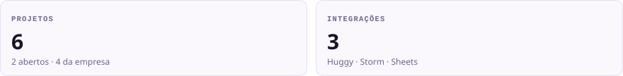

<!-- O painel, os indicadores e a cobrinha são gerados pela Action "painel" toda madrugada.
     Para mudar textos e números, edite o painel.json (não os SVGs). -->

<picture>
  <source media="(prefers-color-scheme: dark)" srcset="assets/painel-dark.svg">
  
</picture>

<picture>
  <source media="(prefers-color-scheme: dark)" srcset="assets/kpis-dark.svg">
  
</picture>

## atividade

<picture>
  <source media="(prefers-color-scheme: dark)" srcset="assets/cobrinha-dark.svg">
  
</picture>

## módulos carregados

| camada | módulos |
|---|---|
| **dados** | `python 3.13` `pandas` `numpy` `sql` `postgresql 17` `power bi` |
| **backend** | `django 6` `django rest framework` `jwt` `gunicorn` |
| **assíncrono** | `celery` `celery beat` `rabbitmq` `redis` |
| **integrações** | `huggy api` `storm` `google sheets api` `pabx solutions` `smarters` `netdata` `webhooks` |
| **interface** | `chart.js` `bootstrap` `tailwind` `html` `css` `javascript` |
| **qualidade** | `docker` `github actions` `ruff` `pytest` `git` |

## projetos

| projeto | status | stack | o que entrega |
|---|---|---|---|
| **Dashboard de Vendas** |  | Django · Celery · Redis · PostgreSQL | indicadores comerciais por sala, coordenador e corretor, atualizados a cada minuto |
| **Dashboard de Formalização** |  | Django · Celery · PostgreSQL | esteira de formalização, com versão mobile, sincronizada a cada 2 min |
| **Dashboard de Auditoria** |  | Django · Celery · React | consultas de simulação por banco e tabela, a cada 5 min |
| **Dashboard Analytics** |  | Django · Celery · pandas | leilão, CRM e disparos consolidados a cada 20 min |
| **Huggy Sync** |  | Django · PostgreSQL · Docker | atendimentos da Huggy gravados em tempo real, por webhook |
| **Central de Monitoramento** |  | Django · Python | CPU, memória e disco dos servidores, coletados a cada 60 s |
| [**Biblioteca de Identidade Visual**](https://github.com/devruthc/biblioteca-identidade-visual-vip-) |  | CSS | componentes e estilos com a cara da empresa |
| [**disparos.py**](https://github.com/devruthc/disparos.py) |  | Python | automação de disparos de mensagens |

<b>como este painel se atualiza sozinho</b>

 

Toda madrugada, às 03:00, uma GitHub Action:

1. busca minhas contribuições na API GraphQL do GitHub;
2. roda o [`gerar_painel.py`](scripts/gerar_painel.py), que lê o [`painel.json`](painel.json) e desenha o painel e os indicadores em SVG, nas versões clara e escura;
3. gera a cobrinha com o [Platane/snk](https://github.com/Platane/snk);
4. faz o commit só quando algo mudou.

feito com carinho e Python

